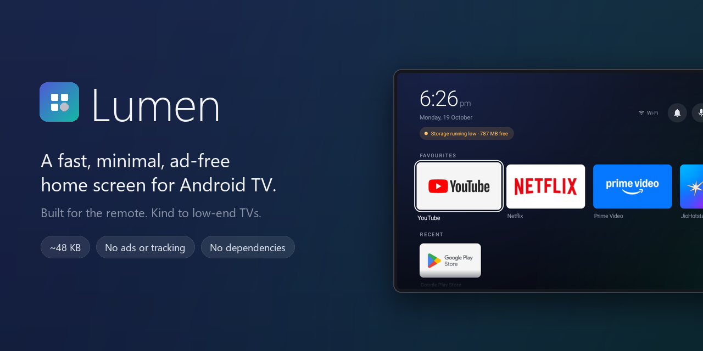
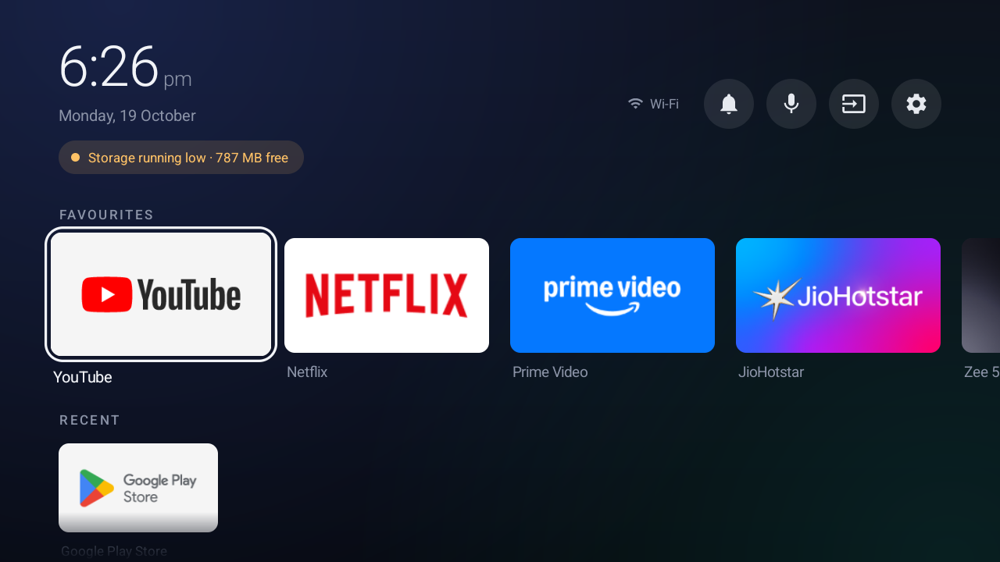
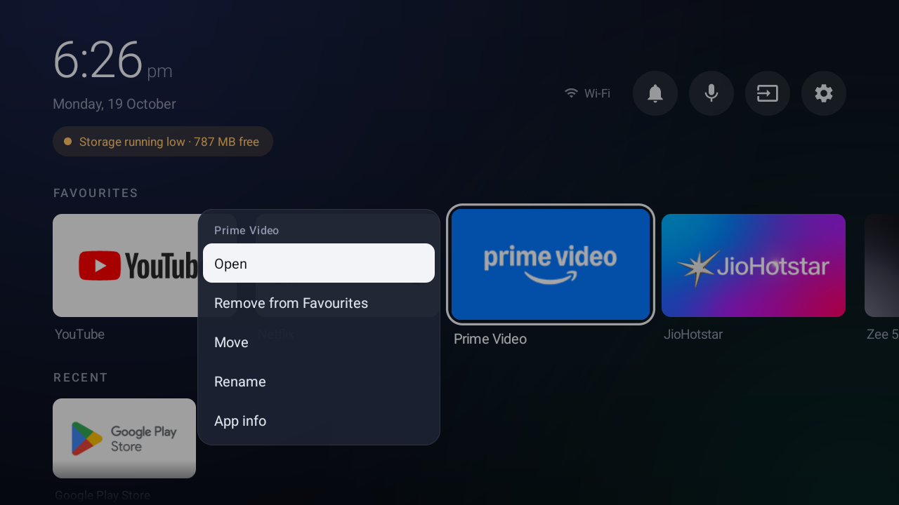
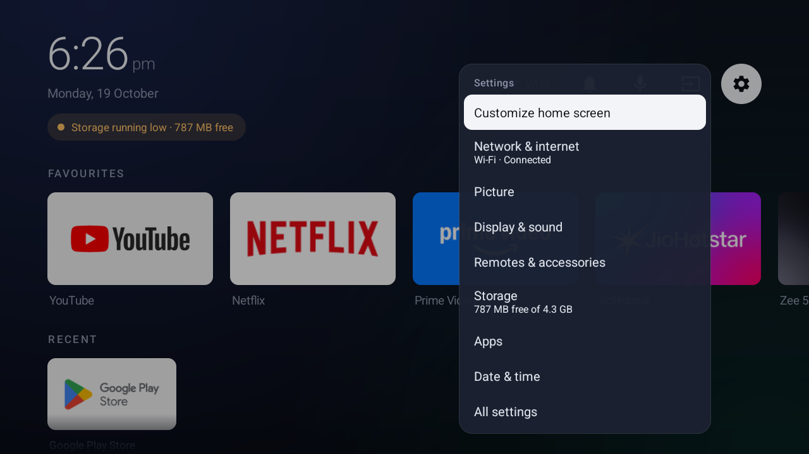
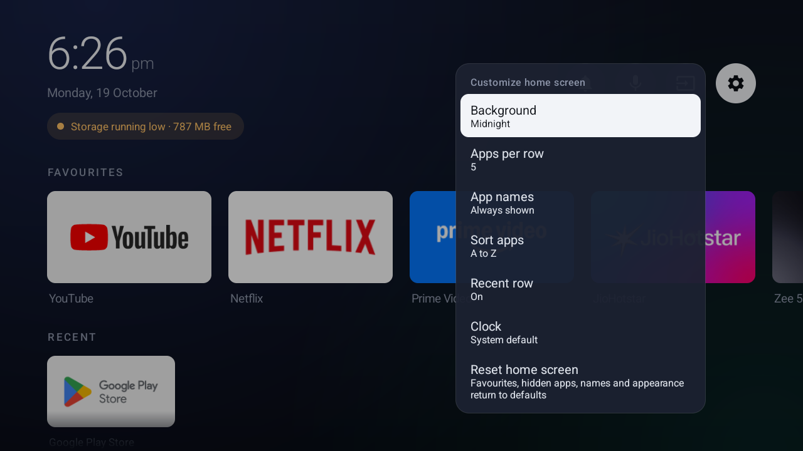
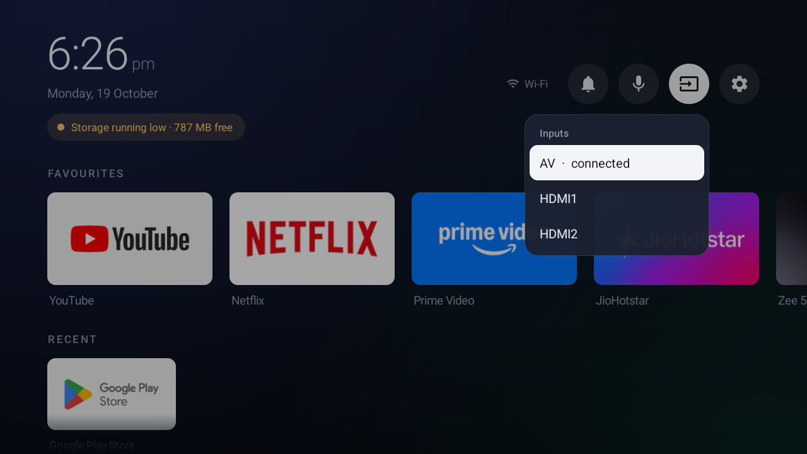
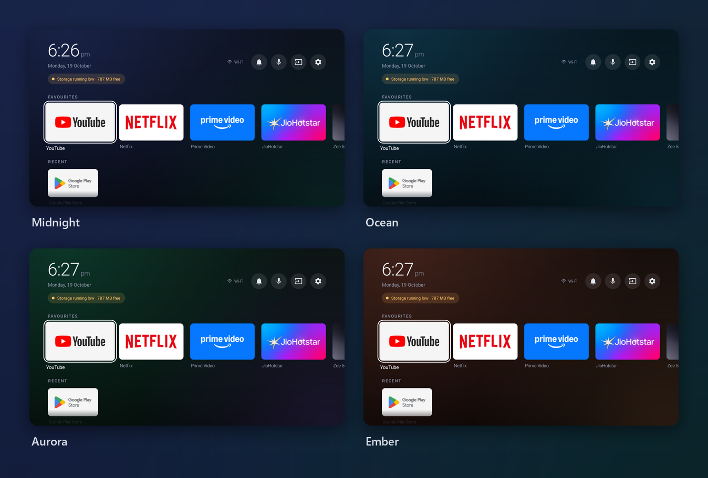

<p align="center">
  
</p>

<p align="center">
  <a href="https://github.com/anand34577/lumen-tv-launcher/releases/latest"></a>
  <a href="https://github.com/anand34577/lumen-tv-launcher/actions/workflows/build.yml"></a>
  
  <a href="LICENSE"></a>
</p>

# Lumen

**Lumen is a home screen for Android TV that gets you to your apps and stays out of the way.**
There are no sponsored rows, no recommendation feeds and no tracking. Lumen doesn't even ask for
internet access.

Stock TV launchers are some of the heaviest apps on a cheap TV. On the 1.5 GB set Lumen was built
for, the stock launcher and its helper services held about 400 MB of memory between them. Lumen is a
~48 KB APK written against the plain Android framework, with no third-party libraries.

It also comes with optional [TV tools](docs/TV-TOOLS.md) to back up a TV, switch off preinstalled
bloat reversibly, and restore everything with one command.

## What you get

- **Your apps, up front.** A Favourites row with large banners, a Recent row, and a grid of everything
  else.
- **Made for the remote.** A focus outline that stays visible even on white banners, smooth scaling,
  and every action reachable with the D-pad, OK and Back.
- **Small menus where you are.** Hold OK on an app to pin, move, rename, hide or uninstall it. The menu
  opens right beside it.
- **It tells you when something's wrong.** Alerts under the clock for no network, Wi‑Fi without
  internet, Wi‑Fi that needs sign-in, and low or full storage. Select one to go straight to the fix.
- **Notifications, inputs, voice search and settings** in a slim top bar.
- **Make it yours.** Six backgrounds, 4–6 apps per row, names always or only on focus, sorting by name,
  use or install date, and a 12/24-hour clock.

## Screenshots

| Home | App menu |
|---|---|
|  |  |
| **Settings** | **Customize** |
|  |  |

<p align="center"></p>

### Themes



Graphite and Black (for OLED panels) are included as well.

## Quick start

You need a computer with [`adb`](https://developer.android.com/tools/releases/platform-tools) on the
same network as the TV, with debugging turned on in the TV's developer options.

```bash
adb connect 192.168.1.50:5555                     # your TV's IP address
adb install -r lumen-v1.2.0.apk                   # from the latest release
adb shell cmd role add-role-holder --user 0 android.app.role.HOME com.lumen.tvlauncher 0
adb shell cmd notification allow_listener com.lumen.tvlauncher/com.lumen.tvlauncher.NotificationService
adb shell input keyevent KEYCODE_HOME
```

If Home still opens the old launcher, your TV ignores the default. Disable the stock one; this is
fully reversible:

```bash
adb shell pm disable-user --user 0 com.google.android.tvlauncher   # undo: pm enable
```

The [install guide](docs/INSTALL.md) walks through every step, including enabling debugging, checking
the download, updating, and uninstalling safely.

## Documentation

| Guide | What's in it |
|---|---|
| [Install](docs/INSTALL.md) | Requirements, step-by-step setup, updating, going back, uninstalling |
| [User guide](docs/USER-GUIDE.md) | Every screen, menu, alert and setting, plus a remote cheat sheet |
| [TV tools](docs/TV-TOOLS.md) | Backup, reversible debloat and restore scripts, and how to adapt them to your TV |
| [Troubleshooting](docs/TROUBLESHOOTING.md) | Fixes for the problems people actually run into |
| [Building](docs/BUILDING.md) | Building from source, signing, project layout |
| [Releasing](docs/RELEASING.md) | Signing key, repository secrets, and publishing a release |
| [Changelog](CHANGELOG.md) | What changed in each version |

## Compatibility

| | |
|---|---|
| Android TV 8.0 (API 26) and newer | Supported |
| Android TV 14, Realtek-based Acer TV, 1.5 GB RAM | Tested daily |
| Google TV | Should work; the stock launcher package is `com.google.android.apps.tv.launcherx` |
| Amazon Fire TV | Not supported. Fire OS won't let another app handle the Home button |

## Privacy

Lumen has no internet permission and sends nothing anywhere. Favourites, names and settings stay in
its private storage on the TV. Notification access is optional and only used to show the badge and
list on the home screen.

## Contributing

Bug reports, fixes for other TV models and translations are welcome. Please read
[CONTRIBUTING.md](CONTRIBUTING.md) first; the project deliberately has no dependencies and no network
use.

## License

[MIT](LICENSE)
